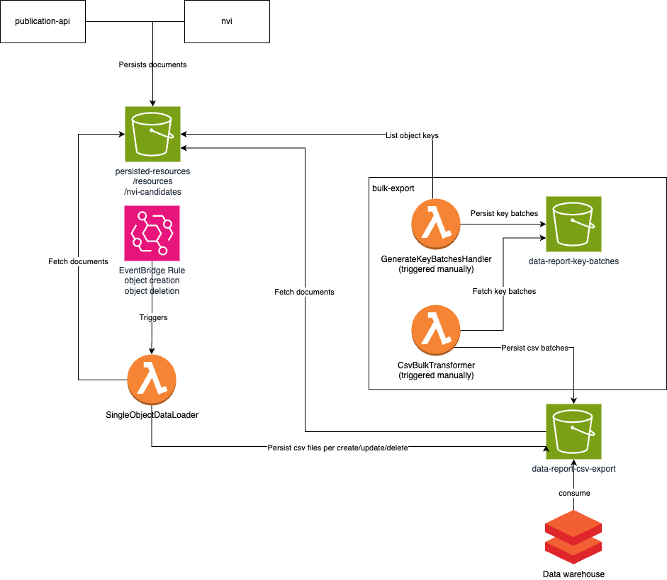
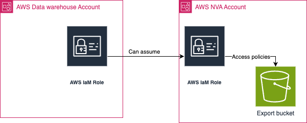

# NVA Data Report API

> [!WARNING]
> This service is decommissioned.
> The stack only contains the S3 buckets, with lifecycle rules that empty
> them so the stack can be deleted.
> The Lambda functions are no longer deployed, and the rest of this README
> describes the service as it was.
> The code is left as it last ran, and the [last full template][last-template]
> is in the history.

This repository contains functions for generating csv reports of data from NVA.
See [reportTypes](documentation/reportTypes.md) for a list of reports and data types.

## Architectural overview

## Integration overview

The s3 bucket `data-report-csv-export-{accountName}` (defined in template) is
set up as a data source in Databricks (in another AWS account) following
databricks [guide _Create a storage credential for connecting to AWS S3_](https://docs.databricks.com/en/connect/unity-catalog/storage-credentials.html#create-a-storage-credential-for-connecting-to-aws-s3).
This is how the data platform accesses files from
`data-report-csv-export-{accountName}`:

## How-to guides

- [Run bulk export](documentation/bulkExport.md)

[last-template]: https://github.com/BIBSYSDEV/nva-data-report-api/blob/2d3a30ae0d98264fc964c20d04d233e4123df164/template.yaml
